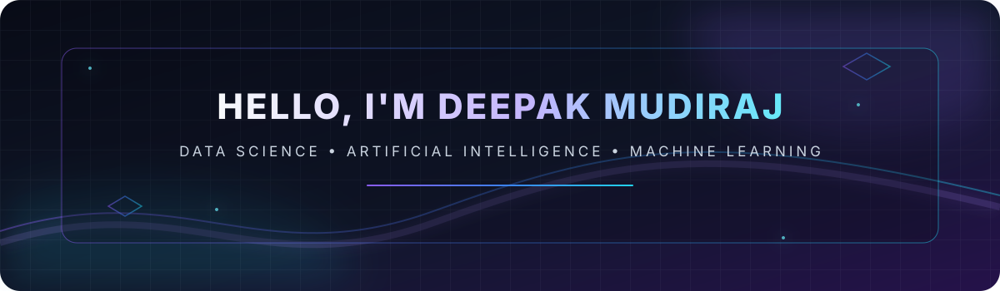

<div align="center">

<a href="https://github.com/deepakMudiraj06">
  
</a>

<br>


<sub>Static fallback: <a href="./portfolio-assets/typing-animation.svg">typing card</a></sub>

<br><br>

<a href="mailto:attemdeepakmudiraj@gmail.com"></a>
<a href="https://github.com/deepakMudiraj06"></a>
<a href="https://www.linkedin.com/in/attem-deepak-mudiraj-/"></a>

<br><br>


</div>


## `01` — About Me

<table>
<tr>
<td width="58%" valign="top">

I’m **Deepak Mudiraj**, an MCA Data Science student focused on building practical solutions with data, machine learning, and modern software development.

I enjoy transforming datasets into useful insights, experimenting with AI/ML systems, and creating applications that solve real-world problems. I’m continuously strengthening my technical and problem-solving skills through hands-on projects.

</td>
<td width="42%" valign="top">

```text
CURRENTLY
└─ MCA in Data Science
   Alliance University · 2025–2027

PREVIOUSLY
└─ B.Sc. (Honors) in Data Science
   Bhavan's Vivekananda College · 2022–2025

FOCUS
└─ Analytics · ML · Deep Learning
   AI · Python · Software Development
```

</td>
</tr>
</table>


## `02` — Technical Arsenal

### Programming


### Data Analytics


### Machine Learning


### Deep Learning


### Development & Tools


## `03` — Selected Work

<table>
<tr>
<td width="50%" valign="top">

### [Kumbh Mela Crowd Detection](https://github.com/deepakMudiraj06/kumbh-mela-crowd-detection)

Crowd-monitoring prototype for person detection, density estimation, heatmap generation, and proximity-based risk analysis.

`Python` `YOLOv8` `OpenCV` `Streamlit`

**Reported result:** detection recall improved from **28.95% to 72.61%**.

<a href="https://github.com/deepakMudiraj06/kumbh-mela-crowd-detection">VIEW REPOSITORY →</a>

</td>
<td width="50%" valign="top">

### [NyayaMitra AI](https://github.com/deepakMudiraj06/NyayaMitra-)

AI-assisted legal information application using embeddings, vector search, and contextual response generation.

`Python` `FastAPI` `React` `FAISS` `SQLite` `LLMs`

<a href="https://github.com/deepakMudiraj06/NyayaMitra-">VIEW REPOSITORY →</a>

</td>
</tr>
<tr>
<td width="50%" valign="top">

### [Fashion Recommendation System](https://github.com/deepakMudiraj06/Fashion-Recommendation-System-Using-Deep-Learning-)

Image-based fashion recommendation system using feature extraction and similarity-based recommendations.

`Python` `ResNet50` `VGG16` `Vision Transformer`

**Reported result:** approximately **95.06% accuracy** with ResNet50.

<a href="https://github.com/deepakMudiraj06/Fashion-Recommendation-System-Using-Deep-Learning-">VIEW REPOSITORY →</a>

</td>
<td width="50%" valign="top">

### [Wildlife Species Classification](https://github.com/deepakMudiraj06/Wildlife-Species-Classification-Using-Audio-)

Audio classification using Mel spectrogram preprocessing and deep learning experiments, including EfficientNet.

`Python` `EfficientNet` `Deep Learning` `Mel Spectrograms`

<a href="https://github.com/deepakMudiraj06/Wildlife-Species-Classification-Using-Audio-">VIEW REPOSITORY →</a>

</td>
</tr>
<tr>
<td width="50%" valign="top">

### [Bengaluru Route Optimization](https://github.com/deepakMudiraj06/Bengaluru_route_optimization)

Graph-based route optimization and pathfinding project using Dijkstra and A* concepts.

`Python` `Dijkstra` `A*`

<a href="https://github.com/deepakMudiraj06/Bengaluru_route_optimization">VIEW REPOSITORY →</a>

</td>
<td width="50%" valign="top">

### [CyberBank Dashboard](https://github.com/deepakMudiraj06/cyber-shikhar)

Modern responsive banking dashboard interface with a focused frontend experience.

`React` `JavaScript` `HTML` `CSS`

<a href="https://github.com/deepakMudiraj06/cyber-shikhar">VIEW REPOSITORY →</a>
<br>
<a href="https://cyber-bank06.netlify.app/">OPEN LIVE DEMO →</a>

</td>
</tr>
</table>


## `04` — Experience

### United Network of Professionals (UNP) · Data Science Intern

| Applied Work | Contribution |
|---|---|
| World Macro Dataset | Regression |
| Insurance Dataset | Classification |
| Data preparation | Cleaning and preprocessing |
| Analysis | Exploratory Data Analysis |
| Modeling | Machine Learning implementation |


## `05` — Education

<table>
<tr>
<td width="50%" valign="top">

### MCA — Data Science

**Alliance University**  
2025–2027

</td>
<td width="50%" valign="top">

### B.Sc. (Honors) — Data Science

**Bhavan's Vivekananda College**  
2022–2025

</td>
</tr>
</table>


## `06` — GitHub Analytics

<div align="center">


<br>


</div>

<sub>All statistics are generated dynamically from GitHub activity. Values are not hardcoded.</sub>

### Contribution Snake

The workflow at [`.github/workflows/snake.yml`](./.github/workflows/snake.yml) generates the contribution snake and publishes it to the `output` branch after its first successful run.

<div align="center">

<picture>
  <source media="(prefers-color-scheme: dark)" srcset="https://raw.githubusercontent.com/deepakMudiraj06/deepakMudiraj06/output/github-contribution-grid-snake.svg">
  
</picture>

</div>

<sub>If the asset is not visible yet, run the workflow manually once from the repository’s Actions tab.</sub>


## `07` — Let’s Connect

I’m interested in connecting with people, exploring opportunities, and building meaningful technology solutions.

<div align="center">

<a href="mailto:attemdeepakmudiraj@gmail.com"></a>
<a href="https://github.com/deepakMudiraj06"></a>
<a href="https://www.linkedin.com/in/attem-deepak-mudiraj-/"></a>

<br><br>

<sub>Designed for GitHub README compatibility · Built around data, AI, and practical software development</sub>

</div>
